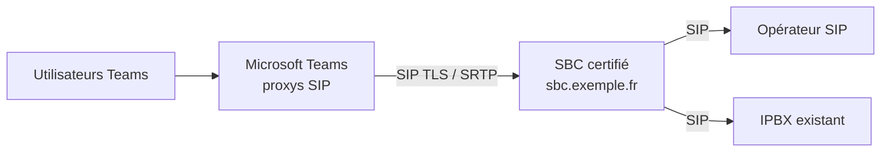

**Teams Phone** transforme Microsoft Teams en téléphone d'entreprise : numéro direct, appels vers le réseau public, standard automatique, files d'attente, transfert, messagerie vocale (transcrite), postes certifiés Teams. Il faut une licence **Teams Phone** (incluse dans Microsoft 365 E5, en option sinon) et un moyen de **connexion au réseau téléphonique**.

## Connexion au réseau téléphonique

| Option | Principe | Pour qui |
| --- | --- | --- |
| **Forfaits d'appels Microsoft** (*Calling Plans*) | Microsoft est l'opérateur, numéros achetés dans le centre d'administration | Simplicité, pays couverts (dont la France) |
| **Operator Connect** | Un opérateur partenaire connecte son réseau à Teams ; numéros attribués depuis le centre d'administration | Garder son opérateur sans gérer de SBC |
| **Direct Routing** | Votre **SBC certifié** (ou celui d'un intégrateur) relie Teams à votre opérateur SIP ou à votre IPBX existant | Coexistence avec un IPBX (Mitel, Alcatel, Cisco…), contrôle total, sites particuliers |
| Teams Phone Mobile | Le numéro mobile de l'opérateur devient le numéro Teams | Utilisateurs mobiles |

## Direct Routing : prérequis

| Élément | Exigence |
| --- | --- |
| SBC | Modèle **certifié** pour Direct Routing (AudioCodes, Ribbon, Oracle, Cisco CUBE, Anynode…), voir [[12-sbc-passerelles/01-sbc\|SBC]] |
| FQDN | Nom du SBC dans un **domaine vérifié** du locataire Microsoft 365 (ex. `sbc.exemple.fr`) |
| Certificat | Certificat public (autorité reconnue par Microsoft) correspondant au FQDN |
| Signalisation | SIP **TLS** sur un port public (souvent 5061) vers `sip.pstnhub.microsoft.com`, `sip2.pstnhub.microsoft.com`, `sip3.pstnhub.microsoft.com` |
| Média | **SRTP** ; plages de ports documentées par Microsoft (avec ou sans *media bypass*) |
| Utilisateurs | Licence Teams Phone, numéro attribué, stratégie de routage vocal |

## Centre d'administration Teams

`https://admin.teams.microsoft.com` :

| Menu | Usage |
| --- | --- |
| *Voix → Numéros de téléphone* | Commander, porter, attribuer des numéros (forfaits Microsoft, Operator Connect) |
| *Voix → Routage direct* | SBC (état, santé, sessions), stratégies de routage, utilisations RTC, itinéraires |
| *Voix → Plans de numérotation* | Normalisation des numéros composés (0… → +33…) |
| *Voix → Standards automatiques* et *Files d'attente* | Accueil, menus, horaires, distribution vers des agents |
| *Voix → Stratégies d'appel*, *Stratégies de parcage* | Renvois, messagerie, délégation, parcage |
| *Emplacements → Adresses d'urgence* | Adresses pour les appels d'urgence (obligatoires avec les forfaits Microsoft) |
| *Appareils Teams* | Téléphones, Teams Rooms, casques : inventaire, configuration, mises à jour |
| *Analyse et rapports* | **Call Analytics** (par utilisateur), **Call Quality Dashboard** (CQD, tendances) |

La configuration en masse et l'automatisation se font en PowerShell : [[02-powershell-administration|administration PowerShell]].

## Clients

| Plateforme | Client |
| --- | --- |
| Windows, macOS | Application Teams |
| Linux | Teams dans le navigateur (ou application web progressive) |
| Android, iOS | Application Teams |
| Postes | Téléphones certifiés Teams (Yealink, Poly, Cisco…), Teams Rooms, Teams Phone pour appareils Android |

## Dépannage

| Symptôme | Cause | Solution |
| --- | --- | --- |
| SBC « inactif » dans le centre d'administration | Pas de `OPTIONS` du SBC, certificat ou FQDN incorrect, pare-feu | Vérifier les sondes OPTIONS, le certificat (chaîne complète), les flux TLS vers les proxys Microsoft |
| L'utilisateur ne voit pas le clavier numérique | Licence, numéro ou stratégie de routage manquants | `Get-CsOnlineUser`, attribution numéro + stratégie |
| Appels sortants refusés | Aucun itinéraire ne correspond au numéro normalisé | Plan de numérotation, `Test-CsVoiceNormalizationRule`, motif de l'itinéraire |
| Audio absent | SRTP, ports média, *media bypass* mal configuré | Journaux du SBC, plages de ports Microsoft |
| Qualité médiocre | Réseau (Wi-Fi, VPN qui force le trafic Teams) | CQD, contournement VPN (*split tunnel*) pour les flux Teams |
