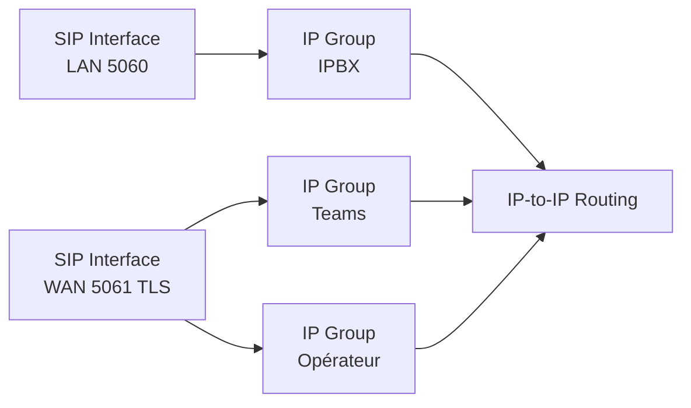

Un **SBC** (*Session Border Controller*) est un B2BUA placé à la frontière du réseau : il termine chaque session SIP d'un côté et la recrée de l'autre. C'est le « pare-feu applicatif » de la téléphonie.

| Fonction | Apport |
| --- | --- |
| Sécurité | Filtrage, limitation de débit, protection contre les balayages et l'inondation, masquage de la topologie interne |
| NAT | Traversée pour les télétravailleurs et les trunks, relais média |
| Normalisation | Réécriture des en-têtes et des numéros pour rendre compatibles deux équipements (IPBX ↔ opérateur) |
| Média | Transcodage (G.711 ↔ G.729 ↔ Opus), SRTP ↔ RTP, DTMF, fax T.38 |
| Interconnexion | Trunks opérateurs, **Teams Direct Routing**, liaison entre IPBX |
| Survie | Mode local (*SBA*, survie de branche) si le lien vers le cloud tombe |

## AudioCodes Mediant

Gamme la plus répandue en entreprise (Mediant 500/800/1000/2600/4000/9000, **Mediant VE/CE** virtuels, certifiés Teams et de nombreux IPBX). Administration par **interface web** (assistant de configuration Teams, *Topology View*), **CLI** (SSH) et **OVOC** (gestion centralisée d'un parc).

### Logique de configuration



| Objet | Rôle |
| --- | --- |
| *Network Interfaces* / *Media Realms* | Adresses IP et plages de ports média par réseau |
| **SIP Interfaces** | Ports d'écoute SIP (UDP/TCP/TLS) rattachés à une interface réseau |
| **Proxy Sets** | Adresses des équipements distants (opérateur, IPBX, proxys Teams), sondes `OPTIONS` |
| **IP Groups** | Entité logique (IPBX, opérateur, Teams) : proxy set, profil, manipulations |
| *IP Profiles* | Comportement média : codecs, SRTP, DTMF, transcodage |
| **IP-to-IP Routing** | Règles : source (IP Group, numéros) → destination |
| *Message Manipulations* | Réécriture d'en-têtes SIP (expression conditionnelle + action) |
| *Inbound/Outbound Manipulations* | Transformation des numéros (préfixes, E.164) |
| *Coders Groups* | Listes de codecs |

### CLI (commandes de supervision usuelles)

```audiocodes
show system version
show voip calls active
show voip calls statistics
show voip proxy sets status
show voip register db sbc list
show voip ip-group 1 status
debug syslog-server 10.0.98.20 port 514
write
reload now
```

(L'arborescence complète de configuration est accessible par `configure voip` et l'aide `?` ; la syntaxe exacte dépend de la version du micrologiciel.)

### Diagnostic

- **Syslog Viewer** (outil Windows AudioCodes) : messages SIP en temps réel, filtres, échelle d'appel.
- **Debug Recording** : capture des paquets SIP/RTP vers Wireshark (avec le dissecteur AudioCodes).
- Tableau de bord web : état des proxy sets (vert/rouge), appels actifs, alarmes.

## Autres SBC

| SBC | Administration | Remarques |
| --- | --- | --- |
| **Ribbon** SBC SWe Edge / Core | Interface web (EMA), CLI | Certifié Teams, très présent chez les opérateurs |
| **Oracle Enterprise SBC** (ex-Acme Packet) | **ACLI** : `configure terminal`, puis `verify-config`, `save-config`, `activate-config` ; `show sipd agents`, `show sipd status` | Référence opérateurs et grands comptes |
| **Cisco CUBE** | IOS XE (`voice service voip` → `mode border-element`, dial-peers) | Avec CUCM, Webex Calling, Teams |
| **Anynode** (TE-Systems) | Interface web (Windows/Linux) | SBC logiciel certifié Teams, populaire en Europe |
| Libres | Kamailio + rtpengine, FreeSWITCH | Voir [[05-kamailio-opensips/01-kamailio\|Kamailio]] |

## Dépannage

| Symptôme | Piste |
| --- | --- |
| Proxy set rouge | Sondes `OPTIONS` sans réponse : routage, pare-feu, certificat TLS, FQDN |
| Appel rejeté par le SBC | Aucune règle de routage ne correspond (vérifier IP Group source, numéros) |
| `488` entre Teams et l'opérateur | SRTP d'un côté, RTP de l'autre : profil IP avec conversion |
| Numéro présenté refusé par l'opérateur | Format (E.164/national), en-tête `P-Asserted-Identity` : manipulation sortante |
| Audio unidirectionnel | Media Realm, adresse NAT publique, ports média fermés |
