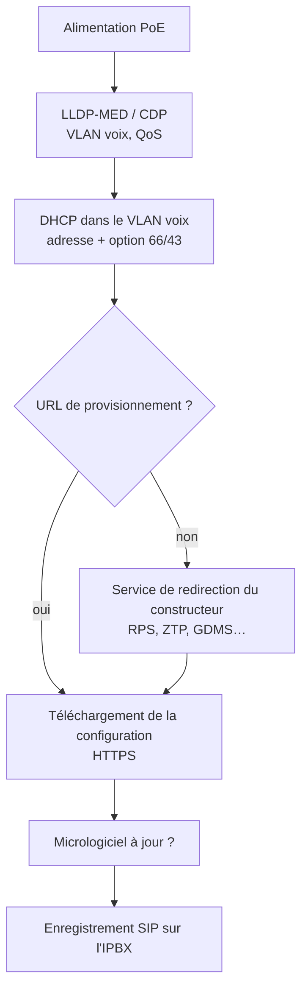

## Constructeurs et outils

| Constructeur | Gammes | Outils de gestion |
| --- | --- | --- |
| **Yealink** | T3x, T4x, T5x, AX/W (DECT) | Interface web du poste, **RPS** (redirection), **YMCS** (gestion cloud) |
| **Poly** (HP) | VVX, Edge E/B, CCX (Teams) | Interface web, **ZTP**, Poly Lens |
| **Grandstream** | GRP, GXP, WP (Wi-Fi), DP (DECT) | Interface web, **GDMS** |
| **Snom** | D7xx, D8xx, M (DECT) | Interface web, **SRAPS** |
| **Fanvil** | X, V | Interface web, **FDPS** |
| **Cisco** | 6800/7800/8800 MPP | Micrologiciel MPP (SIP tiers), **Webex Device Management** / EDOS |
| Mitel | 6800/6900 | Voir [[27-mitel/01-reseau-telephonie-ip\|Mitel]] |

## Séquence de démarrage



## Options DHCP

| Option | Usage |
| --- | --- |
| **66** | URL du serveur de provisionnement (`https://prov.exemple.fr/yealink/`) — la plus universelle |
| 43 | Informations constructeur (encodage spécifique) |
| **150** | Serveur TFTP pour les téléphones Cisco (CUCM/CME) |
| 160 | URL de provisionnement (Poly) |
| 42, 2 | NTP, décalage horaire |

Exemple pour Kea ([[02-kea/01-presentation-installation|Kea DHCP]]) :

```json
{
  "subnet4": [{
    "id": 40,
    "subnet": "10.0.40.0/24",
    "pools": [ { "pool": "10.0.40.50 - 10.0.40.250" } ],
    "option-data": [
      { "name": "routers", "data": "10.0.40.1" },
      { "name": "tftp-server-name", "data": "https://prov.exemple.fr/yealink/" },
      { "name": "ntp-servers", "data": "10.0.10.123" }
    ]
  }]
}
```

(`tftp-server-name` est le nom Kea de l'option 66.)

## Serveur de provisionnement

Un simple serveur web **HTTPS** (Nginx, Apache) sert les fichiers : configuration commune par modèle et fichier par poste nommé d'après l'**adresse MAC**. Protégez-le (authentification HTTP par poste ou certificat client, réseau voix uniquement) : les fichiers contiennent des mots de passe SIP. Les IPBX (3CX, FreePBX EndPoint Manager, Wazo…) génèrent souvent ces fichiers eux-mêmes.

```yealink
#!version:1.0.0.1
## /var/www/prov/yealink/805ec0a1b2c3.cfg — poste d'Alice Martin
account.1.enable = 1
account.1.label = 1001
account.1.display_name = Alice Martin
account.1.auth_name = 1001
account.1.user_name = 1001
account.1.password = Xq7vR2pL9mZt4KwBn3Hs
account.1.sip_server.1.address = pbx.exemple.fr
account.1.sip_server.1.port = 5061
## 0 = UDP, 1 = TCP, 2 = TLS
account.1.sip_server.1.transport_type = 2
## 2 = SRTP obligatoire
account.1.srtp_encryption = 2
account.1.codec.g722.enable = 1
account.1.codec.pcma.enable = 1
static.security.user_password = admin:MotDePasseAdminPoste2026
local_time.time_zone = +1
local_time.time_zone_name = France(Paris)
local_time.ntp_server1 = 10.0.10.123
lang.gui = French
static.auto_provision.server.url = https://prov.exemple.fr/yealink/
static.auto_provision.repeat.enable = 1
static.auto_provision.repeat.minutes = 1440
```

## Sécurité des postes

- [ ] Mot de passe administrateur du poste changé (provisionnement), interface web désactivée ou limitée
- [ ] Provisionnement en **HTTPS** avec authentification ; jamais de fichiers de configuration accessibles depuis Internet
- [ ] SIP TLS + SRTP, micrologiciel à jour (vulnérabilités régulières sur les interfaces web des postes)
- [ ] Port PC du poste : VLAN données uniquement, 802.1X si possible (le poste s'authentifie aussi)
- [ ] Services de redirection constructeur verrouillés sur votre compte (empêche un tiers de rediriger vos postes)

## DECT IP

Les bornes **DECT IP** (Yealink W70B/W80, Snom M500/M900, Gigaset N870, Mitel SIP-DECT, Ascom) relient des combinés sans fil à l'IPBX en SIP. Points d'attention : planification de la couverture (relevés sur site), synchronisation entre bornes (radio ou LAN), *handover* entre bornes, capacité d'appels simultanés par borne, chiffrement DECT activé.

## Dépannage

| Symptôme | Cause | Solution |
| --- | --- | --- |
| Poste dans le mauvais VLAN | LLDP-MED absent, port mal configuré | Vérifier le commutateur (`show lldp neighbors detail`) |
| Pas de configuration téléchargée | Option 66 absente ou erronée, HTTPS refusé (certificat) | Journal du serveur web, page d'état du poste |
| « Échec de l'enregistrement » | Identifiants, transport, horloge (TLS) | Journal SIP de l'IPBX, NTP |
| Combiné DECT qui coupe en se déplaçant | Couverture, synchronisation des bornes | Relevé de couverture, ajout de bornes |
