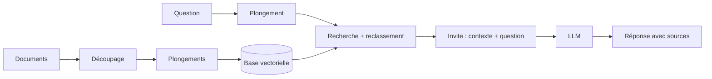

## Le RAG en bref

Un LLM ne connaît ni vos procédures ni vos documents. Le **RAG** (*Retrieval-Augmented Generation*) va chercher les passages pertinents et les fournit au modèle avec la question.



| Étape | Points d'attention |
| --- | --- |
| Ingestion | Extraire proprement le texte des PDF, tableaux, pages web |
| Découpage | Morceaux de 300–1 000 jetons avec chevauchement, en respectant les titres |
| Plongements | Modèle multilingue pour le français (bge-m3, multilingual-e5, nomic-embed) |
| Base vectorielle | pgvector, Qdrant, Chroma, Milvus, Weaviate, OpenSearch |
| Récupération | Recherche **hybride** (vecteurs + BM25) puis **reclassement** (*reranker*) |
| Génération | Demander de citer les sources et de répondre « je ne sais pas » hors contexte |
| Évaluation | Jeu de questions de référence, mesures de fidélité et de pertinence (Ragas, DeepEval) |

## LangChain

**LangChain** (MIT) est le framework le plus répandu : des briques interchangeables pour modèles, chargeurs, découpeurs, magasins vectoriels et outils. **LangGraph** construit des **agents** sous forme de graphes d'états (boucles, validation humaine, persistance).

```bash
python3 -m pip install langchain langchain-ollama langchain-community langchain-text-splitters langchain-chroma pypdf
```

```python
from langchain_ollama import ChatOllama, OllamaEmbeddings
from langchain_community.document_loaders import PyPDFDirectoryLoader
from langchain_text_splitters import RecursiveCharacterTextSplitter
from langchain_chroma import Chroma
from langchain_core.prompts import ChatPromptTemplate

docs = PyPDFDirectoryLoader("procedures/").load()
morceaux = RecursiveCharacterTextSplitter(chunk_size=1000, chunk_overlap=150).split_documents(docs)
base = Chroma.from_documents(morceaux, OllamaEmbeddings(model="nomic-embed-text"), persist_directory="index")
recherche = base.as_retriever(search_kwargs={"k": 5})

invite = ChatPromptTemplate.from_template(
    "Réponds uniquement à partir du contexte et cite la source.\nContexte :\n{contexte}\n\nQuestion : {question}")
llm = ChatOllama(model="qwen2.5:7b", temperature=0)

question = "Quelle est la procédure de bascule du pare-feu ?"
contexte = "\n\n".join(f"[{d.metadata['source']} p.{d.metadata.get('page')}] {d.page_content}" for d in recherche.invoke(question))
print((invite | llm).invoke({"contexte": contexte, "question": question}).content)
```

**LangSmith** (service, en partie payant) trace et évalue les exécutions ; des alternatives libres auto-hébergeables existent (Langfuse, Arize Phoenix).

## LlamaIndex

**LlamaIndex** (MIT) est centré sur la **connexion des données** : chargeurs nombreux (LlamaHub), index, moteurs de requête et de dialogue, **workflows** d'agents.

```bash
python3 -m pip install llama-index llama-index-llms-ollama llama-index-embeddings-ollama
```

```python
from llama_index.core import VectorStoreIndex, SimpleDirectoryReader, Settings, StorageContext, load_index_from_storage
from llama_index.llms.ollama import Ollama
from llama_index.embeddings.ollama import OllamaEmbedding

Settings.llm = Ollama(model="qwen2.5:7b", request_timeout=120)
Settings.embed_model = OllamaEmbedding(model_name="nomic-embed-text")

index = VectorStoreIndex.from_documents(SimpleDirectoryReader("procedures/").load_data())
index.storage_context.persist("index")            # réutiliser : load_index_from_storage(StorageContext.from_defaults(persist_dir="index"))
reponse = index.as_query_engine(similarity_top_k=5).query("Qui valide une demande d'ouverture de flux ?")
print(reponse, [n.metadata.get("file_name") for n in reponse.source_nodes])
```

**LlamaParse** (service) améliore l'extraction des PDF complexes ; en local, des outils comme Docling ou Unstructured jouent ce rôle.

## Haystack

**Haystack** (Apache 2.0, deepset) assemble des **composants** typés en **pipelines** explicites, sérialisables en YAML : approche appréciée pour la production et la recherche documentaire.

```bash
python3 -m pip install haystack-ai ollama-haystack
```

```python
from haystack import Pipeline, Document
from haystack.document_stores.in_memory import InMemoryDocumentStore
from haystack.components.retrievers.in_memory import InMemoryBM25Retriever
from haystack.components.builders import PromptBuilder
from haystack_integrations.components.generators.ollama import OllamaGenerator

store = InMemoryDocumentStore()
store.write_documents([Document(content="Le VLAN 20 est réservé à la téléphonie IP."),
                       Document(content="Les imprimantes sont dans le VLAN 30.")])

gabarit = """Contexte :
- {{ d.content }}
Question : {{ question }}
Réponse :"""
p = Pipeline()
p.add_component("recherche", InMemoryBM25Retriever(document_store=store))
p.add_component("invite", PromptBuilder(template=gabarit))
p.add_component("llm", OllamaGenerator(model="qwen2.5:7b", url="http://localhost:11434"))
p.connect("recherche.documents", "invite.documents")
p.connect("invite", "llm")
q = "Quel VLAN pour les téléphones ?"
print(p.run({"recherche": {"query": q}, "invite": {"question": q}})["llm"]["replies"][0])
```

**Hayhooks** expose un pipeline Haystack en API REST (et compatible OpenAI) ; les DocumentStores couvrent OpenSearch, Elasticsearch, Qdrant, pgvector, Weaviate…

## Choisir

| Critère | LangChain / LangGraph | LlamaIndex | Haystack |
| --- | --- | --- | --- |
| Point fort | Écosystème le plus vaste, agents (LangGraph) | Ingestion et indexation de données | Pipelines explicites, production |
| Courbe d'apprentissage | API qui évolue vite | Rapide pour un RAG simple | Structure plus stricte |
| Usage typique | Agents, intégrations multiples | RAG sur documents variés | Recherche documentaire d'entreprise |

Pour une solution prête à l'emploi sans développement, voir [[02-ragflow-quivr|RAGFlow et Quivr]] ou [[05-constructeurs-applications/01-dify|Dify]]. Commandes : [[90-aide-memoire|aide-mémoire]].
