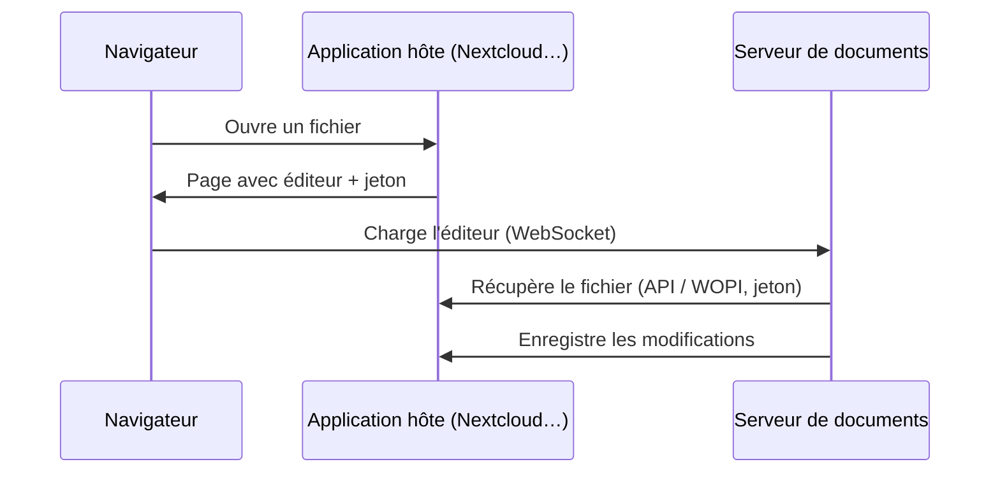

ONLYOFFICE Docs et Collabora Online sont des **serveurs d'édition** : ils affichent et modifient documents, classeurs et présentations dans le navigateur, à plusieurs simultanément. Ils ne stockent pas les fichiers : une **application hôte** (Nextcloud, Seafile, une GED, un ENT) les leur confie.



## ONLYOFFICE Docs Community

Ses formats natifs sont ceux de **Microsoft Office** (DOCX, XLSX, PPTX) : la compatibilité de mise en page avec Office est son point fort. L'édition communautaire est limitée à **20 connexions simultanées** (au-delà, éditions commerciales).

```bash
docker run -d --name onlyoffice --restart=always -p 127.0.0.1:8081:80 \
  -e JWT_ENABLED=true -e JWT_SECRET='<secret long partagé avec l hôte>' \
  -v /srv/onlyoffice/logs:/var/log/onlyoffice \
  -v /srv/onlyoffice/data:/var/www/onlyoffice/Data \
  -v /srv/onlyoffice/lib:/var/lib/onlyoffice \
  -v /srv/onlyoffice/db:/var/lib/postgresql \
  onlyoffice/documentserver
curl -s http://127.0.0.1:8081/healthcheck          # renvoie true
```

Intégration Nextcloud : application **ONLYOFFICE** (connecteur), puis dans ses réglages l'adresse publique `https://office.exemple.fr/` et la même clé secrète JWT.

```bash
sudo -u www-data php occ app:install onlyoffice
sudo -u www-data php occ config:app:set onlyoffice DocumentServerUrl --value="https://office.exemple.fr/"
sudo -u www-data php occ config:app:set onlyoffice jwt_secret --value="<même secret>"
```

## Collabora Online (CODE)

**Collabora Online** est **LibreOffice côté serveur** : formats ODF natifs, très bonne fidélité ODT/ODS/ODP, protocole **WOPI**. **CODE** (Collabora Online Development Edition) est l'édition libre gratuite, destinée à un usage limité (petites structures, tests) ; Collabora propose des abonnements pour la production.

```bash
docker run -d --name collabora --restart=always -p 127.0.0.1:9980:9980 \
  -e "aliasgroup1=https://cloud\\.exemple\\.fr:443" \
  -e "username=admin" -e "password=<mot de passe de la console>" \
  -e "extra_params=--o:ssl.enable=false --o:ssl.termination=true" \
  collabora/code
curl -s http://127.0.0.1:9980/hosting/discovery | head -5
# Console d'administration : https://office.exemple.fr/browser/dist/admin/admin.html
```

- `aliasgroup1` liste les **hôtes WOPI autorisés** (expression régulière) : sans cela, n'importe quel site pourrait utiliser votre serveur.
- `ssl.termination=true` quand le TLS est terminé par le proxy inverse.
- Configuration détaillée : `/etc/coolwsd/coolwsd.xml` (polices, langues, limites de documents).

Intégration Nextcloud : application **Nextcloud Office** (`richdocuments`), URL du serveur Collabora dans Administration → Office.

```bash
sudo -u www-data php occ app:install richdocuments
sudo -u www-data php occ config:app:set richdocuments wopi_url --value="https://office.exemple.fr"
sudo -u www-data php occ richdocuments:activate-config
```

## Proxy inverse

Les deux serveurs utilisent des **WebSocket** : le proxy doit les relayer.

```nginx
location / {
    proxy_pass http://127.0.0.1:9980;           # 8081 pour ONLYOFFICE
    proxy_http_version 1.1;
    proxy_set_header Upgrade $http_upgrade;
    proxy_set_header Connection "upgrade";
    proxy_set_header Host $host;
    proxy_set_header X-Forwarded-Proto $scheme;
    proxy_read_timeout 36000s;
    client_max_body_size 100m;
}
```

## Dimensionnement et choix

Compter environ **1 cœur et 1 à 2 Go de RAM pour 10 à 20 éditeurs actifs** (variable selon la taille des documents), plus de la marge pour les conversions.

| Critère | ONLYOFFICE Docs CE | Collabora CODE |
| --- | --- | --- |
| Formats natifs | OOXML (DOCX, XLSX, PPTX) | ODF (ODT, ODS, ODP) |
| Fidélité avec Microsoft Office | Très bonne | Bonne |
| Interface | Proche de Microsoft Office | Proche de LibreOffice (mode onglets possible) |
| Limite de l'édition libre | 20 connexions simultanées | Usage limité, sans support, messages d'avertissement |
| Intégrations | Nextcloud, Seafile, ownCloud, Moodle, Odoo… | Nextcloud, ownCloud, Seafile, Pydio… (WOPI) |

Voir aussi : [[02-libreoffice-openoffice|LibreOffice et Apache OpenOffice]] · [[09-fichiers-partage/08-nextcloud/01-presentation-installation|Nextcloud]]. Commandes : [[90-aide-memoire|aide-mémoire]].
