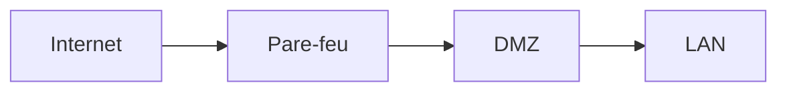

**MkDocs** transforme un dossier de fichiers **Markdown** en **site de documentation statique**. Avec le thème **Material for MkDocs**, c'est l'une des façons les plus simples de publier une documentation d'équipe soignée, versionnée dans Git et relue par merge request (« **docs as code** »).

## Démarrer

```bash
python3 -m venv .venv && . .venv/bin/activate
python3 -m pip install mkdocs-material          # installe aussi MkDocs
mkdocs new doc-infra && cd doc-infra
mkdocs serve -a 127.0.0.1:8000                  # aperçu avec rechargement automatique
mkdocs build --strict                           # site/ ; --strict échoue sur les liens cassés
```

```text
doc-infra/
├── mkdocs.yml
└── docs/
    ├── index.md
    ├── reseau/
    │   ├── vlans.md
    │   └── pare-feu.md
    └── procedures/
        └── sauvegarde.md
```

```yaml mkdocs.yml
site_name: Documentation infrastructure
site_url: https://doc.exemple.fr/
repo_url: https://gitlab.exemple.fr/infra/doc
theme:
  name: material
  language: fr
  features:
    - navigation.tabs
    - navigation.sections
    - navigation.top
    - search.suggest
    - search.highlight
    - content.code.copy
    - content.code.annotate
  palette:
    - scheme: default
      toggle: { icon: material/brightness-7, name: Mode sombre }
    - scheme: slate
      toggle: { icon: material/brightness-4, name: Mode clair }
plugins:
  - search: { lang: fr }
  - privacy                     # télécharge polices et ressources externes : site autonome (RGPD, intranet)
markdown_extensions:
  - admonition
  - pymdownx.details
  - pymdownx.superfences:
      custom_fences:
        - { name: mermaid, class: mermaid, format: !!python/name:pymdownx.superfences.fence_code_format }
  - pymdownx.tabbed: { alternate_style: true }
  - pymdownx.highlight: { anchor_linenums: true }
  - attr_list
  - toc: { permalink: true }
nav:
  - Accueil: index.md
  - Réseau: [ reseau/vlans.md, reseau/pare-feu.md ]
  - Procédures: [ procedures/sauvegarde.md ]
```

## Syntaxe utile (Material)

````markdown
!!! warning "Coupure de service"
    Cette opération redémarre le cluster : prévenir les utilisateurs.

=== "Linux"
    ```bash
    sudo systemctl restart nginx
    ```
=== "Windows"
    ```powershell
    Restart-Service W3SVC
    ```


````

## Publier

```yaml .gitlab-ci.yml
pages:
  image: python:3.12
  script:
    - pip install mkdocs-material
    - mkdocs build --strict --site-dir public
  artifacts: { paths: [ public ] }
  rules: [ { if: $CI_COMMIT_BRANCH == $CI_DEFAULT_BRANCH } ]
```

- **GitHub Pages** : `mkdocs gh-deploy --force` (branche `gh-pages`) ou une action CI.
- **Serveur interne** : copier `site/` dans la racine d'un Nginx (`rsync -a --delete site/ web:/var/www/doc/`) ; c'est un site 100 % statique, sans base de données.
- **Versions** de la documentation (v1, v2, latest) : outil **mike** (`mike deploy --push --update-aliases 2.0 latest`).
- Image Docker officielle : `squidfunk/mkdocs-material` (`docker run --rm -v $PWD:/docs squidfunk/mkdocs-material build`).

> [!NOTE]
> L'équipe de Material for MkDocs a annoncé passer en **mode maintenance** pour se consacrer à un nouvel outil (Zensical), compatible avec les projets existants. Material reste utilisable ; suivre les annonces du projet pour planifier une éventuelle migration.

Voir aussi : [[02-sphinx-readthedocs-documize|Sphinx, Read the Docs et Documize]]. Commandes : [[90-aide-memoire|aide-mémoire]].
