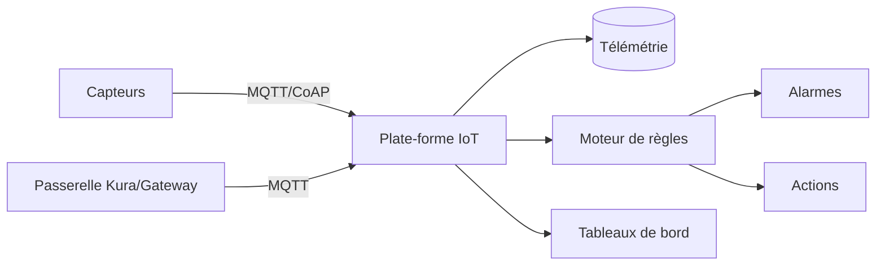

Une **plate-forme IoT** connecte des **flottes d'appareils** (capteurs, passerelles), stocke leur **télémétrie**, applique des **règles** (alarmes, transformations) et offre des **tableaux de bord**. C'est un cran au-dessus d'un simple courtier MQTT et au-delà de la domotique domestique : on vise des centaines ou milliers d'appareils, souvent industriels.

## ThingsBoard Community

**ThingsBoard CE** (Apache 2.0) est la plate-forme IoT open source la plus complète : appareils, ressources, télémétrie, **moteur de règles** visuel, tableaux de bord riches, alarmes, multi-locataires.

| Élément | Rôle |
| --- | --- |
| Device | Appareil connecté, avec attributs et télémétrie |
| Protocoles | **MQTT** (1883), **HTTP**, **CoAP**, **LwM2M**, SNMP |
| Rule Engine | Chaînes de traitement (filtres, transformations, actions, alarmes) |
| Dashboards | Widgets temps réel et historiques |
| Stockage | PostgreSQL (entités) + Cassandra ou **TimescaleDB** (télémétrie à gros volume) |

```bash
docker run -d --name thingsboard --restart unless-stopped \
  -p 127.0.0.1:8080:9090 -p 1883:1883 -p 7070:7070 -p 5683-5688:5683-5688/udp \
  -v /srv/tb/data:/data -v /srv/tb/logs:/var/log/thingsboard \
  thingsboard/tb-postgres
# Interface : http://serveur:8080 ; comptes de démonstration (sysadmin/tenant) à changer
```

- Un appareil publie sa télémétrie en MQTT : `mosquitto_pub -h serveur -t v1/devices/me/telemetry -u <JETON> -m '{"temperature":21.5}'`.
- L'édition communautaire est **mono-nœud** (pas de grappe) ; la montée en charge (microservices, haute disponibilité) relève des éditions PE/Cloud.

## Magistrala (ex-Mainflux)

**Mainflux** est devenu **Magistrala** (Apache 2.0) : une plate-forme IoT **modulaire** écrite en Go, conçue comme un ensemble de microservices. Elle fait surtout le **transport et la gestion** (messagerie multi-protocole MQTT/HTTP/CoAP/WebSocket, entités *things* et *channels*, utilisateurs, politiques, **mTLS**), et se combine à d'autres briques pour le stockage et la visualisation.

```bash
git clone https://github.com/absmach/magistrala && cd magistrala
docker compose -f docker/docker-compose.yml up -d
# API passerelle, puis création d'utilisateurs, de things et de channels via l'API ou le CLI
```

Elle vise les intégrateurs qui veulent **bâtir leur propre solution** sur une base solide, plutôt qu'une plate-forme clé en main comme ThingsBoard.

## Architecture type



## Choisir

| Besoin | Outil |
| --- | --- |
| Plate-forme clé en main (tableaux de bord, règles) | ThingsBoard Community |
| Base modulaire pour bâtir sa solution | Magistrala (Mainflux) |
| Quelques dizaines d'appareils, maison/bâtiment | [[04-domotique/01-home-assistant-openhab-domoticz\|Home Assistant]] |
| Simple collecte MQTT | [[05-mosquitto/01-presentation-configuration\|Mosquitto]] + base + Grafana |

Voir aussi : [[02-kaa-kura|Kaa et Eclipse Kura]] · [[07-lorawan/01-chirpstack-ttn|ChirpStack et The Things Stack]]. Commandes : [[90-aide-memoire|aide-mémoire]].
