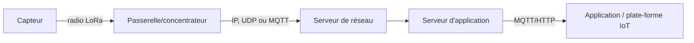

**LoRaWAN** relie des capteurs **basse consommation** sur de **longues distances** (plusieurs kilomètres) : idéal pour relevés de compteurs, capteurs de bâtiment ou agricoles alimentés par pile pendant des années. Un **serveur de réseau** LoRaWAN auto-hébergé évite de dépendre d'un opérateur.

## Principe



| Notion | Rôle |
| --- | --- |
| Passerelle (*gateway*) | Antenne + concentrateur ; relaie les trames radio vers le serveur |
| Serveur de réseau | Gère adresses, sessions, déduplication, adaptation de débit |
| Serveur d'application | Déchiffre les données utiles, les publie vers les applications |
| **OTAA / ABP** | Activation par les airs (clés négociées) ou par personnalisation (clés figées) |
| Classes A/B/C | Compromis entre consommation et latence de réception |
| EU868 | Plan de fréquences européen (respecter la réglementation et le rapport cyclique) |

## ChirpStack

**ChirpStack** (MIT) est la solution LoRaWAN open source de référence. La version actuelle réunit serveur de réseau et serveur d'application dans un seul service, avec un **ChirpStack Gateway Bridge** qui normalise le protocole des passerelles.

```bash
# Dépôt docker-compose officiel : chirpstack, gateway-bridge, PostgreSQL, Redis, Mosquitto
git clone https://github.com/chirpstack/chirpstack-docker && cd chirpstack-docker
docker compose up -d
# Interface : http://serveur:8080 (admin/admin à changer)
```

- Configurer le **plan de fréquences** (EU868) et pointer les passerelles vers le Gateway Bridge (UDP Semtech 1700 ou MQTT selon le modèle).
- **Intégrations** par application : MQTT (`application/<id>/device/<devEUI>/event/up`), HTTP, InfluxDB… pour transmettre les données déchiffrées à une plate-forme ([[05-plateformes-iot/01-thingsboard-mainflux|ThingsBoard]]) ou à un tableau de bord.
- **API** gRPC et REST pour automatiser appareils, profils et clés.

## The Things Stack

**The Things Stack** (TTS) est la pile logicielle derrière **The Things Network** (TTN, réseau communautaire mondial). Son édition **Open Source** s'auto-héberge : composants Identity Server, Network Server, Application Server, Join Server, **console** web et passerelle MQTT.

```bash
# Déploiement Docker Compose fourni par le projet (TTS + PostgreSQL + Redis)
# Nécessite une configuration TLS et des clés ; console web et CLI « ttn-lw-cli »
ttn-lw-cli login
ttn-lw-cli end-devices list --application-id mon-appli
```

On peut l'exploiter en **réseau privé** ou connecter ses passerelles au **réseau public TTN** (couverture mutualisée, gratuite, mais soumise à une politique d'usage équitable).

## Matériel

Une **passerelle** (concentrateur 8 canaux à base de Semtech SX1301/SX1302, ou passerelle du commerce) est indispensable ; un module USB mono-canal ne convient qu'aux tests. Placer l'antenne en hauteur et dégagée.

## Sécurité

- Les clés **AppKey/NwkKey** (OTAA) protègent les communications : les stocker en sécurité, préférer l'OTAA à l'ABP, ne pas réutiliser les clés d'usine.
- Protéger l'interface et l'API (HTTPS, comptes, API keys à portée limitée), changer les comptes par défaut.
- Surveiller le **rapport cyclique** (*duty cycle*) et la réglementation radio EU868.

## Choisir

| Besoin | Outil |
| --- | --- |
| Réseau LoRaWAN privé, simple et complet | ChirpStack |
| Compatibilité TTN, réseau communautaire ou privé | The Things Stack |
| Intégration vers une plate-forme IoT | MQTT depuis ChirpStack/TTS → ThingsBoard, Node-RED, Grafana |

Voir aussi : [[02-mosquitto-iot-gateway|Mosquitto et ThingsBoard Gateway]]. Commandes : [[90-aide-memoire|aide-mémoire]].
