# Test Android de NetWiki

Appareil : Android SDK built for x86_64 — versionCode=10000 minSdk=23 targetSdk=35 versionName=1.0.0 Failed to write while dumping service package: Broken pipe

| | Étape | Détail |
| --- | --- | --- |

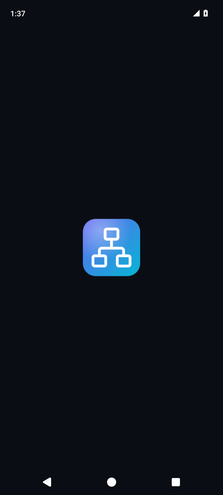

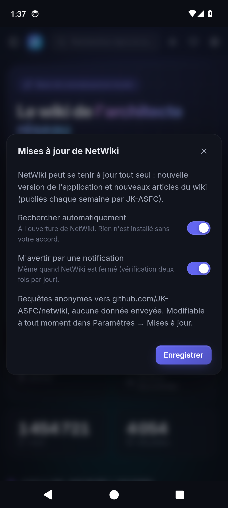

| ✅ | Premier lancement : choix des mises à jour | Mises à jour de NetWiki |

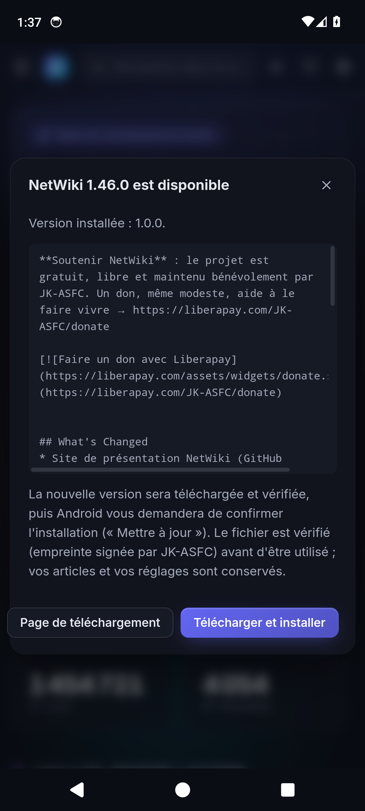

| ✅ | Mise à jour proposée au démarrage (version de test 1.0.0) | NetWiki 1.46.0 est disponible |
| ✅ | Bouton Retour : ferme la fenêtre | fermée |

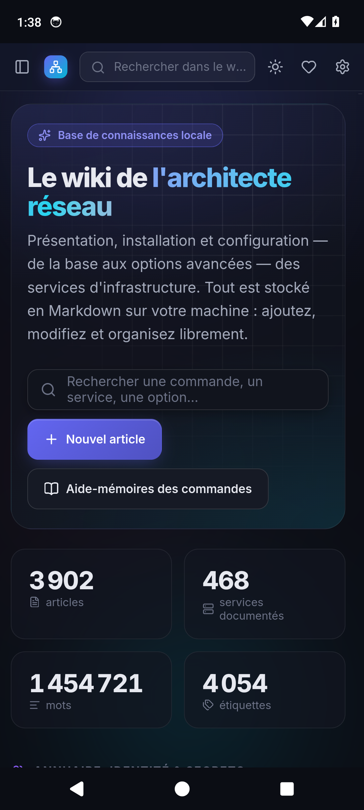

| ✅ | Écran d’accueil |  |

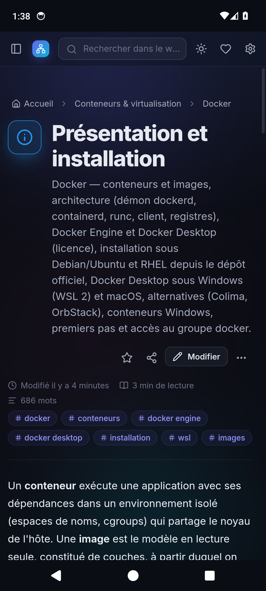

| ✅ | Ouverture d’un article | Présentation et installation |

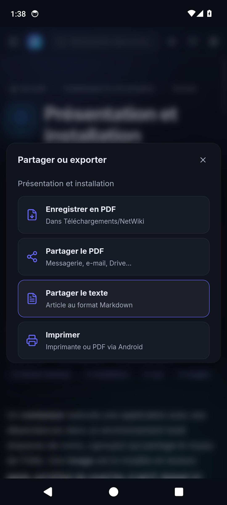

| ✅ | Fenêtre Partager / exporter |  |

| ✅ | Enregistrer en PDF (Téléchargements) | -rwxrwx--- 1 u0_a119 media_rw 501267 2026-11-03 13:38 Présentation\ et\ installation.pdf |

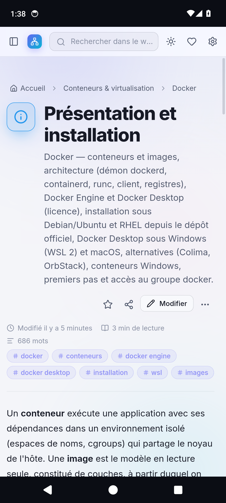

| ✅ | Partager le PDF (sélecteur d’Android) |  |

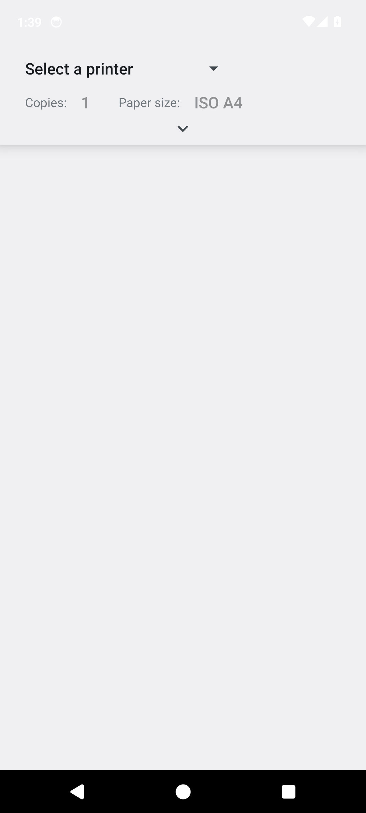

| ✅ | Imprimer (boîte d’impression d’Android) |  |

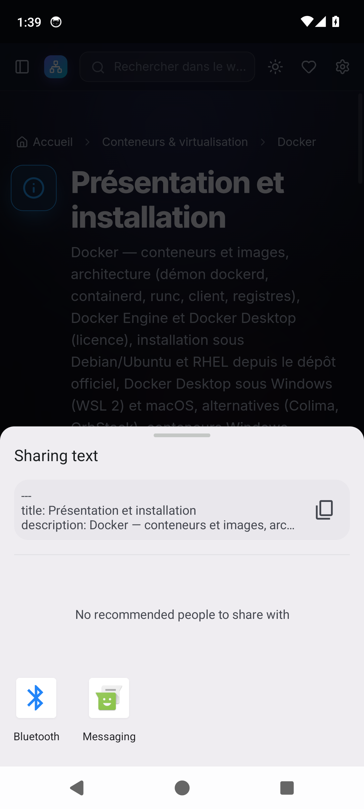

| ✅ | Partager le texte (Markdown) |  |

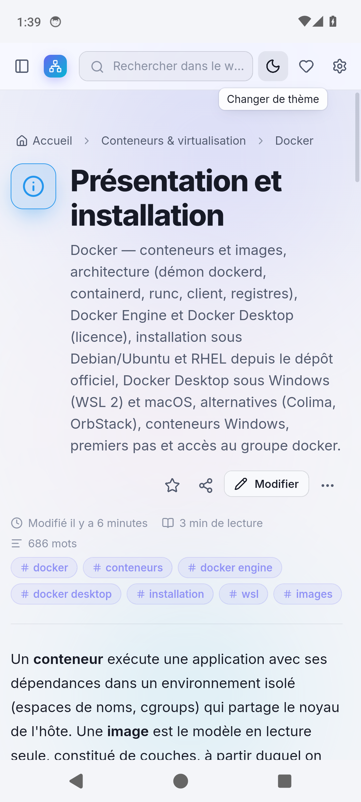

| ✅ | Thème clair (barres système) |  |

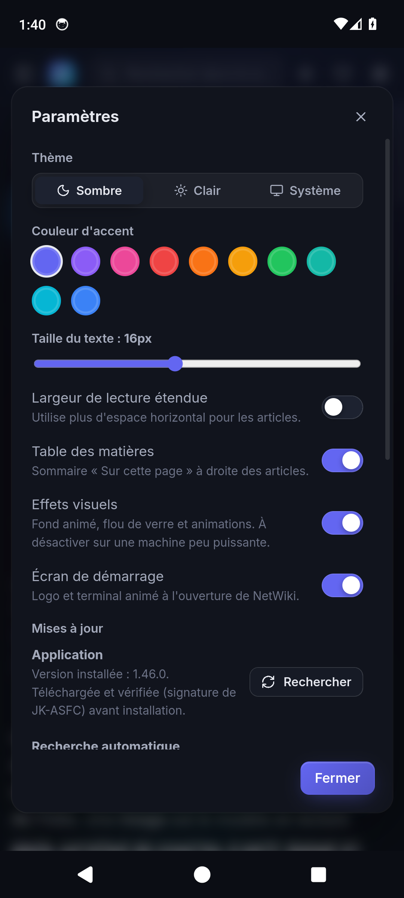

| ✅ | Paramètres → Mises à jour |  |

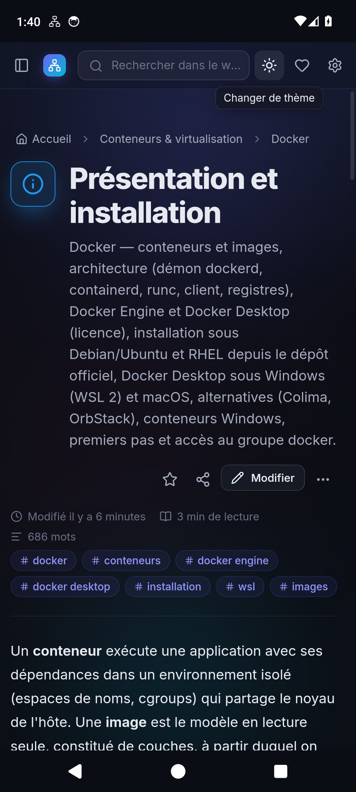

| ✅ | Notification de nouvelle version (tâche de fond) | notification affichée ; nouveaux articles : true |

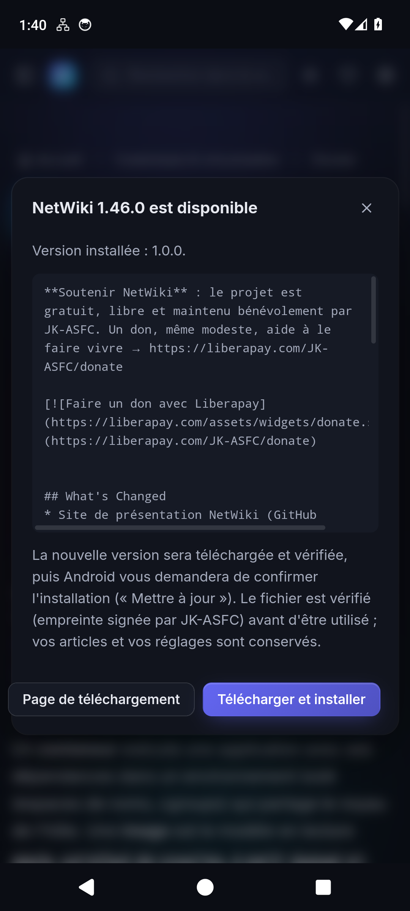

| ✅ | Notification touchée → fenêtre de mise à jour | NetWiki 1.46.0 est disponible |
| ✅ | Téléchargement vérifié (refus d’un APK signé par une autre clé) | SIGNATURE La nouvelle version est signée avec la clé officielle de JK-ASFC, différente de celle de l'application installée (ancienne version de test). Désinstallez NetWiki une seule fois puis installez la nouvelle version : les mises à jour suivantes seront automatiques. |
| ✅ | Empreinte incorrecte refusée | Empreinte du fichier téléchargé incorrecte : mise à jour annulée. |

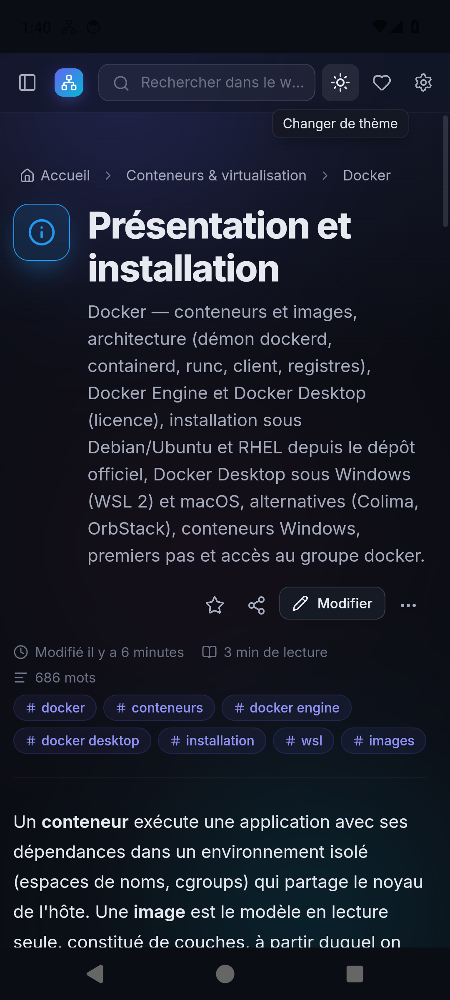

| ✅ | Autorisation « Installer des applications inconnues » |  |

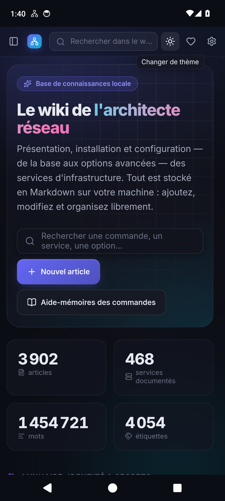

| ✅ | Bouton Retour : article → accueil → sortie | accueil puis application en arrière-plan |

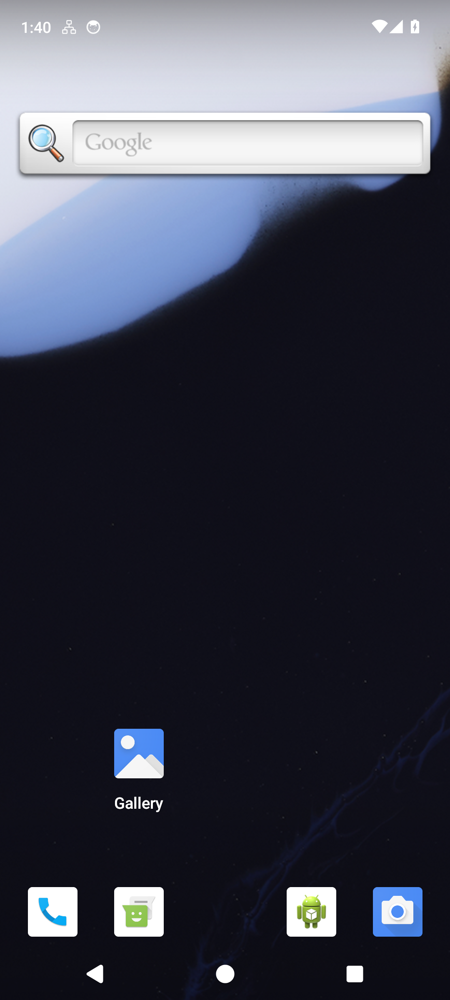

| ✅ | Icône dans le tiroir d’applications |  |
