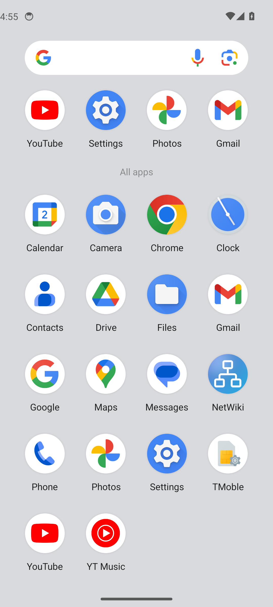

# Test Android de NetWiki

Appareil : sdk_gphone64_x86_64 — versionCode=10000 minSdk=23 targetSdk=35 versionName=1.0.0 Failed to write while dumping service package: Broken pipe

| | Étape | Détail |
| --- | --- | --- |

| ✅ | Premier lancement : choix des mises à jour | Mises à jour de NetWiki |

| ✅ | Mise à jour proposée au démarrage (version de test 1.0.0) | NetWiki 1.45.0 est disponible |
| ✅ | Bouton Retour : ferme la fenêtre | fermée |

| ✅ | Écran d’accueil |  |

| ✅ | Ouverture d’un article | Présentation et installation |

| ✅ | Fenêtre Partager / exporter |  |
| ❌ | Enregistrer en PDF (Téléchargements) | page.waitForFunction: Target page, context or browser has been closed |
| ❌ | Partager le PDF (sélecteur d’Android) | page.click: Target page, context or browser has been closed |
| ❌ | Imprimer (boîte d’impression d’Android) | page.click: Target page, context or browser has been closed |
| ❌ | Partager le texte (Markdown) | page.click: Target page, context or browser has been closed |
| ❌ | Thème clair (barres système) | page.click: Target page, context or browser has been closed |
| ❌ | Paramètres → Mises à jour | page.evaluate: Target page, context or browser has been closed |
| ❌ | Notification de nouvelle version (tâche de fond) | page.evaluate: Target page, context or browser has been closed |
| ❌ | Notification touchée → fenêtre de mise à jour | page.waitForSelector: Target page, context or browser has been closed |
| ❌ | Téléchargement vérifié (refus d’un APK signé par une autre clé) | page.evaluate: Target page, context or browser has been closed |
| ❌ | Empreinte incorrecte refusée | page.evaluate: Target page, context or browser has been closed |
| ❌ | Autorisation « Installer des applications inconnues » | page.evaluate: Target page, context or browser has been closed |
| ❌ | Bouton Retour : article → accueil → sortie | page.evaluate: Target page, context or browser has been closed |

| ✅ | Icône dans le tiroir d’applications |  |
