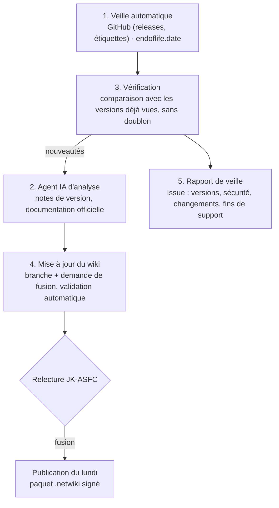

# Veille automatique et agent IA

NetWiki n'est pas un Wiki.js : ses articles sont des fichiers Markdown dans le dépôt GitHub. **L'« API du wiki », c'est GitHub** : une mise à jour = une branche + une demande de fusion (PR) que JK-ASFC relit et fusionne, puis la publication hebdomadaire envoie le contenu signé aux utilisateurs.

## La chaîne de veille

| Étape | Outil | Fichier |
| --- | --- | --- |
| 1. Veille | GitHub Actions, chaque dimanche à 4 h UTC (ou à la demande) | `.github/workflows/veille.yml`, `scripts/veille.mjs` |
| 2. Agent IA | Claude Code (`anthropics/claude-code-action`) : lit les notes de version et la documentation officielle | `.github/workflows/agent.yml` |
| 3. Vérification | Versions déjà vues (branche `veille`), validation complète du wiki avant toute proposition | `scripts/validate.js`, `.github/workflows/verification.yml` |
| 4. Mise à jour | Demande de fusion étiquetée `agent-ia`, jamais fusionnée automatiquement | `agent.yml` |
| 5. Rapport | Issue « Rapport de veille du … » étiquetée `veille` | `veille.yml` |

Les services suivis sont ceux de `docs/catalogue/suivi.json` qui ont un champ `depot` (dépôt GitHub) ou `eol` (produit [endoflife.date](https://endoflife.date)) ; chaque nouvelle fiche les renseigne.

## Ce que l'agent sait faire

| Mode | Lancement | Résultat |
| --- | --- | --- |
| `veille` | Automatique après la veille s'il y a de nouvelles versions | Fiches corrigées (commandes, installation, versions), section « Nouveautés » si utile |
| `catalogue` | *Actions → Agent IA → Run workflow*, nombre de services | Les N prochains services du catalogue rédigés selon `docs/catalogue/METHODE.md` |
| `consigne` | *Actions → Agent IA → Run workflow*, texte libre | Ex. « Ajoute l'interface graphique de Zabbix », « Vérifie les commandes Kea 3.0 » |

Chaque demande de fusion contient le résumé de l'agent (fiches modifiées, sources, points à vérifier, captures à fournir) et le résultat de la validation du wiki.

## À faire par JK-ASFC (une seule fois)

1. **Clé de l'agent** — *Settings → Secrets and variables → Actions → New repository secret* :
   - abonnement **Claude Pro ou Max** : sur un ordinateur où Claude Code est installé, lancez `claude setup-token`, puis créez le secret **`CLAUDE_CODE_OAUTH_TOKEN`** avec la valeur affichée ;
   - ou **API Anthropic** (facturation à l'usage) : secret **`ANTHROPIC_API_KEY`** (clé `sk-ant-…` de console.anthropic.com).
2. **Autoriser les demandes de fusion automatiques** — *Settings → Actions → General → Workflow permissions* : cochez **Read and write permissions** et **Allow GitHub Actions to create and approve pull requests**.
3. **Application Claude pour GitHub** : elle doit être installée sur le dépôt (c'est déjà le cas si Claude Code travaille sur ce dépôt ; sinon https://github.com/apps/claude).
4. **Premier passage de la veille** — *Actions → Veille des services → Run workflow* : il enregistre les versions actuelles et ouvre un premier rapport. Les semaines suivantes, seules les nouveautés sont signalées.
5. **Essai de l'agent** — *Actions → Agent IA → Run workflow*, mode `catalogue`, nombre `2` : une demande de fusion apparaît dans *Pull requests*.

Ensuite, chaque semaine : lire le rapport de veille (Issues), relire les demandes de fusion `agent-ia`, fusionner ou demander des corrections. Pour être prévenu, activez *Watch → Custom → Issues, Pull requests* sur le dépôt (notification par e-mail ou sur l'application GitHub).

## Captures d'écran des interfaces graphiques

Les articles « Interface graphique » contiennent des emplacements invisibles `<!-- CAPTURE: description | _assets/fichier.png -->`. La liste à jour est dans [docs/catalogue/CAPTURES.md](catalogue/CAPTURES.md) (régénérée par `node scripts/captures.mjs`). Déposez l'image au nom indiqué dans le dossier `_assets/` de la fiche, puis lancez `node scripts/captures.mjs --appliquer` : l'emplacement devient une image légendée.

## Coût et limites

- Abonnement Pro/Max : les exécutions consomment le quota de l'abonnement ; API : facturation au nombre de jetons (un service complet rédigé ≈ quelques dizaines de milliers de jetons).
- L'agent peut se tromper : la validation automatique contrôle la forme (liens, tableaux, code), **pas l'exactitude technique** — d'où la relecture obligatoire avant fusion.
- Durée maximale d'une exécution : 3 heures ; pour le catalogue, mieux vaut 3 à 10 services par demande de fusion.

## Alternative entièrement auto-hébergée

Le même circuit peut tourner chez vous avec **n8n** (licence *fair-code*) ou **Node-RED** (open source) et **Ollama** (modèle local) :

1. un déclencheur hebdomadaire lance `node scripts/veille.mjs` (ou interroge l'API GitHub et endoflife.date) ;
2. pour chaque nouveauté, un nœud HTTP envoie la fiche et les notes de version à Ollama (`POST http://serveur:11434/api/chat`) avec la consigne de `docs/catalogue/METHODE.md` ;
3. le texte produit est écrit dans une branche puis proposé via l'API GitHub (`POST /repos/JK-ASFC/netwiki/pulls`, jeton à portée limitée au dépôt) ;
4. la validation `verification.yml` s'exécute sur la demande de fusion.

Limites : un modèle local (8 à 70 milliards de paramètres) rédige moins précisément le français technique et ne vérifie pas seul les sources web ; prévoir un GPU (16 Go de VRAM ou plus) et une relecture plus attentive.
